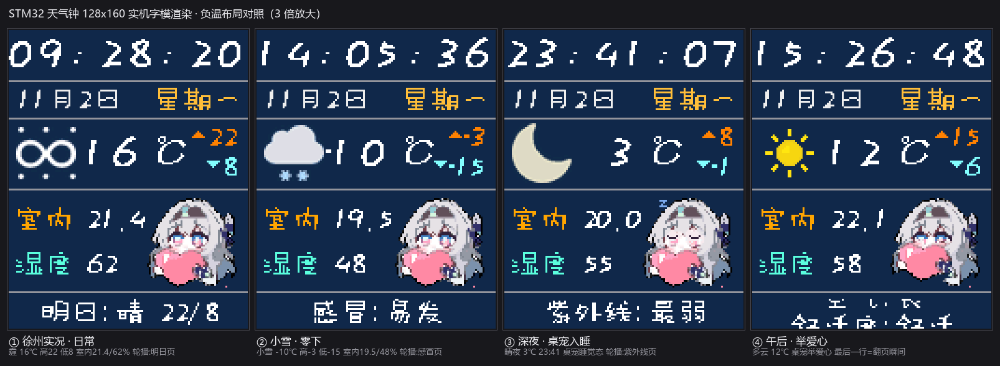

# STM32 智能天气时钟

一块 1.8 寸屏上的桌面天气时钟：联网校时、实况天气、室内温湿度、6 页生活指数轮播，右下角还养了一只会在深夜睡觉的桌宠。

**裸机 STM32F103C8T6，无 RTOS、无第三方库，主循环零阻塞。**



*（真字模渲染图：时间 / 日期 / 天气行 / 室内温湿度 / 桌宠；实物为 128×160 ST7735 彩屏）*


*（桌宠实机动画：呼吸 → 眨眼 → 举爱心 → 深夜入睡；48×48 真帧数据逐帧渲染）*

## 功能

- **时钟**：RTC（外部 32.768kHz 晶振）计数器当 Unix 秒，Hinnant 算法换算日期；开机自动联网校时，未校准时显示 `--:--:--` 而不是 1970 年
- **天气**：心知天气 API，实况（10 分钟周期）+ 3 天预报 + 生活指数；自写流式 JSON 解析器，不建 DOM、不引库
- **显示**：21 个 32×32 天气图标按官方码表归并；负温 3px 小负号；最后一行 6 页轮播（明日天气 / 降水概率 / 感冒 / 紫外线 / 空气 / 舒适度），每页 4 秒、17 帧上下滚动（旧页上滑出新页从下推入）
- **室内环境**：DHT11 两段式采样（拉低即返回、下一圈再读），1 秒一次，不阻塞
- **桌宠**：常驻呼吸 + 随机眨眼 + 随机举爱心 + 整点必举 + 22:00~07:00 睡觉；入睡时背光 1 秒渐暗到 20%，醒来渐亮
- **亮度**：PB10 复用为 TIM2_CH3 PWM 调光，零阻塞改占空比

## 技术要点

| 设计 | 说明 |
|---|---|
| 全状态机架构 | 网络取数（11 状态）、DHT11、轮播、桌宠、背光渐变全部是"每圈推进一步"的状态机，主循环 12ms 一圈没有任何阻塞等待 |
| `ESP_POLL_GAP` | 把阻塞版串口扫描固有的 0~10ms 盲区显式化成一个常数——非阻塞化后模块没收尾就被塞下一条命令会回 `busy p...`，这是本项目踩得最深的一个坑 |
| 流式 JSON 解析 | 一遍遍历、就地取值，SRAM 占用与 JSON 结构无关 |
| 桩测试 | 业务层与硬件隔离，7 个测试 310+ 断言在 PC 上直接编译运行（gcc），不需要开发板 |
| 补丁帧动画 | 屏幕只能写不能读，桌宠每帧只描述变化的矩形，收尾只重画 ~114 像素而非整只 2304 像素 |
| 时基正确性 | `delay_millis()` 每 59652ms 回绕，定时场景统一用累加式 `delay_uptime()`（49.7 天回绕） |
| 图标生成管线 | 官方 PNG → LANCZOS 缩放 → 按背景色量化 16 色 → 4bit 索引，脚本直接生成 C 数组，21 桶零手绘 |
| 资源占用 | Code+RO ≈ 61KB / 128KB flash，RW+ZI ≈ 7.4KB / 20KB RAM，全程静态分配无 malloc |

## 硬件

| 部件 | 型号 / 参数 | 接口 |
|---|---|---|
| MCU | STM32F103C8T6，72MHz | — |
| 屏 | ST7735 1.8 寸 128×160 RGB565（只写不读） | SPI |
| WiFi | ESP-01S（AT 固件） | USART2 115200 |
| 温湿度 | DHT11 | 单总线 GPIO |
| 时钟 | 外部 LSE 32.768kHz | RTC |
| 调试 | USART1 9600（可关） | PA9/PA10 |

## 编译

1. Keil MDK-ARM（AC5）打开 `程序/weather_clock.uvprojx`，直接 Rebuild；
2. 复制 `程序/App/secrets_example.h` 为 `程序/App/secrets.h`，填入 WiFi 账号密码和 [心知天气](https://www.seniverse.com/) 免费 API key（此文件不入库）；
3. 编译判据看 `0 Error(s)`；烧录走 ST-Link。

## 目录

```
程序/
├── App/        业务层: 取数调度、屏幕数据加工、UI、桌宠、JSON 解析
├── Hardware/   驱动层: ESP8266 状态机、ST7735、DHT11、PWM 调光
├── System/     时基: RTC、delay（含 49.7 天不回绕的 uptime）
├── Assets/     字库、天气图标、桌宠帧数据（脚本生成）
├── user/       main.c 主循环
└── FWlib/ CMSIS/  标准外设库
```

更详细的踩坑笔记见 [docs/notes.md](docs/notes.md)。

## 已知取舍

- 开屏联网最长约 85 秒无进度提示
- 冒号不闪烁
- 生活指数 23 项只展示 4 项（屏幕就这么大）
- 心知免费版实况数据本身约 15 分钟更新、滞后 30~60 分钟，本地轮询再快也快不过数据源

## 数据来源

- 天气/生活指数：[心知天气 API](https://docs.seniverse.com/)
- 舒适度：自算国标舒适度公式（温度、湿度、风速三输入，定点 ×100 运算）
- 图标：[心知官方图标包](https://docs.seniverse.com/api/start/code.html) 转换生成

## License

[MIT](LICENSE)
